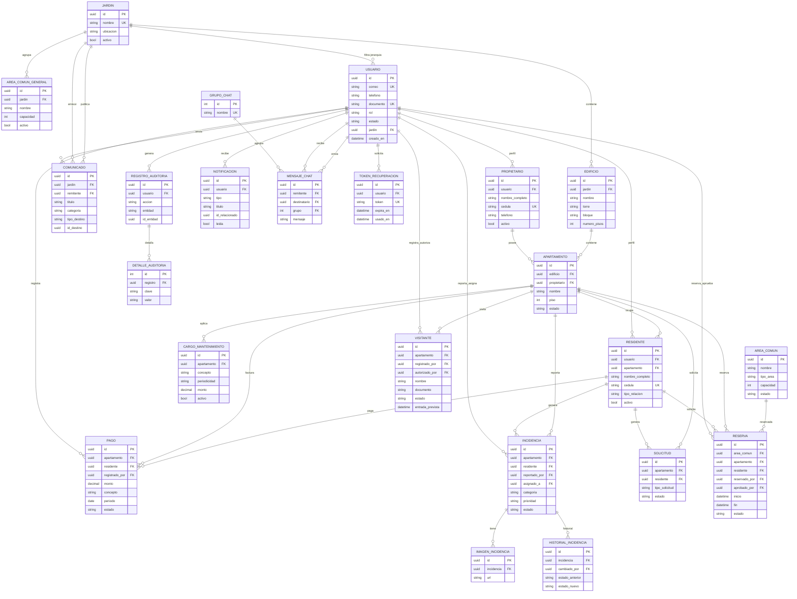

# CONDOSYS — Modelo Entidad-Relación

Diagrama generado a partir de los `models.py` de cada app (Django 6.1).
Todas las claves primarias son `UUIDField` salvo donde se indique.
Los nombres están en español; entre paréntesis el modelo/campo real del código.

## Diagrama general

## Equivalencia con el código

| Entidad (diagrama) | Modelo (código) | App |
|---|---|---|
| `USUARIO` | `User` | `accounts` |
| `JARDIN` | `Garden` | `structure` |
| `EDIFICIO` | `Building` | `structure` |
| `APARTAMENTO` | `Apartment` | `structure` |
| `PROPIETARIO` | `Propietario` | `propietarios` |
| `RESIDENTE` | `Resident` | `residents` |
| `PAGO` | `Payment` | `payments` |
| `CARGO_MANTENIMIENTO` | `MaintenanceCharge` | `maintenance` |
| `INCIDENCIA` | `Incident` | `incidents` |
| `IMAGEN_INCIDENCIA` | `IncidentImage` | `incidents` |
| `HISTORIAL_INCIDENCIA` | `IncidentHistory` | `incidents` |
| `SOLICITUD` | `Solicitud` | `solicitudes` |
| `AREA_COMUN` | `AreaComun` | `areas_comunes` |
| `AREA_COMUN_GENERAL` | `CommonArea` | `reservations` |
| `RESERVA` | `Reservation` | `reservations` |
| `VISITANTE` | `Visitor` | `visitors` |
| `COMUNICADO` | `Communication` | `communications` |
| `NOTIFICACION` | `Notification` | `notifications` |
| `GRUPO_CHAT` | `ChatGroup` | `chat` |
| `MENSAJE_CHAT` | `ChatMessage` | `chat` |
| `TOKEN_RECUPERACION` | `PasswordResetToken` | `login` |
| `REGISTRO_AUDITORIA` | `AuditLog` | `reports` |
| `DETALLE_AUDITORIA` | `AuditLogDetail` | `reports` |

## Entidades independientes (registro único / configuración)

Estos modelos no tienen claves foráneas a otras entidades del flujo principal:

| Entidad | App | Descripción |
|---|---|---|
| `Residencial` | `residencial` | Datos del residencial (registro único, `obtener_unico()`). |
| `IntegracionIA` | `configuracion` | Configuración del proveedor/modelo de IA (`obtener_unica()`). |

## Relaciones destacadas

- **Jerarquía física**: `JARDIN → EDIFICIO → APARTAMENTO` (`CASCADE`).
- **Usuario ↔ perfil**: `USUARIO` se vincula opcionalmente a un `RESIDENTE` (`resident_profiles`) o a un `PROPIETARIO` (`propietario_profiles`).
- **Propiedad vs ocupación**: `Apartamento.owner` apunta a `PROPIETARIO` (`SET_NULL`); los ocupantes se modelan como `RESIDENTE` apuntando al `APARTAMENTO`.
- **Pagos**: `PAGO` referencia `APARTAMENTO` + `RESIDENTE` (`PROTECT`) y guarda `registrado_por` (`USUARIO`, `SET_NULL`).
- **Incidencias**: `INCIDENCIA` cuelga de `APARTAMENTO` (`CASCADE`), con `reportado_por`/`asignado_a` (`USUARIO`), más `IMAGEN_INCIDENCIA` e `HISTORIAL_INCIDENCIA`.
- **Reservas**: `RESERVA` cruza `AREA_COMUN`, `APARTAMENTO`, `RESIDENTE` y `USUARIO` (quien reserva/aprueba).
- **Visitantes**: `VISITANTE` cuelga de `APARTAMENTO` con `registrado_por`/`autorizado_por` (`USUARIO`).
- **Mensajería**: `MENSAJE_CHAT` usa `remitente`, `destinatario` opcional (privado) y `grupo` opcional (grupal).

## Notas de implementación

- `reservations.CommonArea` (`AREA_COMUN_GENERAL`, FK a `JARDIN`) y `areas_comunes.AreaComun` (`AREA_COMUN`, independiente) coexisten; `Reservation.common_area` apunta a **`areas_comunes.AreaComun`**.
- `Communication.target_id` (`id_destino`) y `Notification.related_id` (`id_relacionado`) son `UUIDField` **sin FK** (referencias polimórficas por `target_type`/`type`).
- `User.garden` (`jardin`, `SET_NULL`) se usa solo para filtrar por jerarquía.
